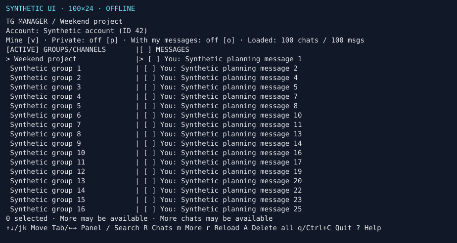

# TG Manager

**TL;DR:** Find all the Telegram messages and comments you’ve ever left in chats,
groups and channel discussions, and delete them one by one or in bulk.
It works with messages Telegram still lets your account access and identifies as yours.

A terminal app for browsing your Telegram history and cleaning up your own messages.



## Get started

You need **Node.js 24+**, macOS or Linux, and an interactive terminal.

```sh
git clone https://github.com/elnights/tg-manager.git
cd tg-manager
npm ci
npm start
```

1. Get your **API ID and hash** from [my.telegram.org](https://my.telegram.org/)
   and enter them when prompted. Choose **Y / Enter** to save them locally for
   future launches, or **N** to use them once.
2. In Telegram, open **Settings → Devices → Link Desktop Device** and scan the
   QR code. Enter your cloud password if asked.
3. Your Telegram login session is saved locally. With saved API credentials,
   later launches open the app without repeating setup while the session is valid.

Saved API credentials are unencrypted and private to your OS user. See
[storage](docs/storage.md#api-credentials) for their location and how to remove them.
You can also use `tg-manager --config /path/to/credentials` or export `TG_API_ID`
and `TG_API_HASH` instead of saving them through the prompt.

Want to try it offline first? Run `npm run repro:emoji` for a synthetic demo.
See the [usage guide](docs/usage.md) for configuration and other installation options.

## Find and delete your messages

Groups and channels appear by default. Press `p` to include private chats and
bots, or `o` to find loaded chats and linked discussions containing your messages.
Use `m` to load more chats; `/` searches loaded chat titles and IDs.

| Key               | What it does                                                                         |
| ----------------- | ------------------------------------------------------------------------------------ |
| `↑` / `↓`, `Tab`  | Navigate and switch panels                                                           |
| `v`               | Switch between your messages and all authors                                         |
| `Enter`           | Read a message, post or album                                                        |
| `Space`, then `d` | Mark a message and review deletion; mark several for bulk deletion                   |
| `s`               | Select your loaded messages, with an option to load the rest                         |
| `A`               | Find all your messages in the focused chat or discussion scope, then review deletion |
| `?`               | Show all keyboard shortcuts                                                          |
| `q`               | Quit                                                                                 |

Keys are case-sensitive. Channels show both posts and their linked discussion;
`t` switches the discussion between one post’s comments and the entire group.
Deletion applies to the focused message pane.

**Deletion is irreversible.** Every deletion requires typing `DELETE` and pressing
Enter after reviewing the account, target and message count. `A` scans the full
focused scope before asking; it does not delete automatically. `Esc` cancels a
prompt or stops further requests, but cannot undo a deletion already sent.

## More information

- [Usage guide](docs/usage.md) — browsing, comments, media and deletion details
- [Keyboard reference](docs/keyboard.md) — all shortcuts
- [Storage and limits](docs/storage.md) — saved sessions, migration and Telegram limitations
- [Contributing](CONTRIBUTING.md) — development, validation and architecture
- [Security policy](SECURITY.md) — private vulnerability reporting

## License

[WTFPL](LICENSE) — Do What The Fuck You Want To Public License.
Use it, modify it, fork it, sell it, or throw it away. No permission needed.
