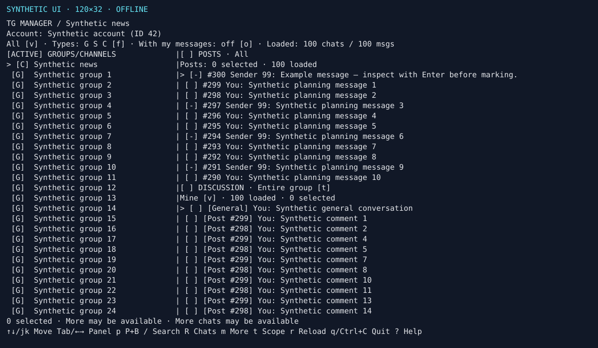

# Usage guide

Start with the [README](../README.md) for installation and the basic workflow.
This guide covers configuration, browsing, media and deletion behavior.
See the [keyboard reference](keyboard.md) for every shortcut and prompt.

## Installation options

Requires Node.js 24+, macOS or Linux, and an interactive terminal.
After the first npm release is published, you can install the CLI globally:

```sh
npm install --global tg-manager-tui
tg-manager
```

Use `tg-manager --demo` for an offline preview with synthetic data.
`--help` lists CLI options; `--version` prints the installed version.
For source installs and synthetic development previews, see
[Contributing](../CONTRIBUTING.md).

## Credentials and login

Get your API ID and hash from [my.telegram.org](https://my.telegram.org/).
The app asks for missing credentials and masks the hash. After you enter a valid
pair, choose **Y / Enter** to save it locally or **N** to use it for this run only.
Saving lets later launches reuse the pair automatically. If saving fails, choose
Y to retry or N to continue without saving.
You can also export `TG_API_ID` and `TG_API_HASH`, or use
`tg-manager --config /path/to/credentials`. These take priority over saved
credentials and are not automatically copied into local storage. An incomplete
or invalid environment pair opens setup rather than mixing sources.
Explicit configuration must contain valid credentials. From source, `npm start`
also loads a local `.env` when present.

Scan the QR code in Telegram: **Settings → Devices → Link Desktop Device**.
Enter your cloud password if prompted. Later launches reuse the private session
in your user data directory, independently of the launch directory.
The Telegram login session is saved whether credentials come from the prompt,
environment variables or `--config`. If you choose N, later launches ask for
API credentials again unless you supply them through environment variables or
a credentials file. That prompt does not mean you need to scan the QR code again;
QR login is needed if the saved session is missing or no longer authorized.
See [API credential storage](storage.md#api-credentials) for the saved file,
permissions and removal instructions.
See [storage and migration](storage.md) before moving an existing install.

## Controls and status

| Key                        | Action                                                                    |
| -------------------------- | ------------------------------------------------------------------------- |
| `↑` / `↓`, `j` / `k`       | Navigate the focused panel                                                |
| `Tab`, `←`, `→`            | Switch panels                                                             |
| `Page Up/Down`, `Home/End` | Page / first or last loaded item in either panel                          |
| `/`, `R`, `m`              | Search loaded chats / refresh list / load more chats                      |
| `g`                        | Focus the source post of the current discussion comment                   |
| `Enter`                    | Inspect a message in a read-only scrolling view                           |
| `r`, `!`                   | Reload messages or retry initialization / read notice details             |
| `f`                        | Choose any combination of chat types                                      |
| `o`                        | Show only loaded chats containing your own messages                       |
| `v`                        | Switch Mine / All in the focused message pane                             |
| `t`                        | Switch discussion scope: selected post / entire linked group              |
| `Space`, `s`, `c`          | Mark one / select all / clear selection                                   |
| `n`, **`L`**               | Load next page / remaining view                                           |
| `d`                        | Confirm deletion of marked own messages                                   |
| `?`                        | Open the complete keyboard reference                                      |
| `Esc`                      | Cancel a prompt, stop work after the current request, or dismiss an alert |
| `q`, `Ctrl+C`              | Quit from the main view / anytime                                         |

Keys are case-sensitive. The top strip shows Mine/All, enabled chat types,
and exact loaded chat/message counts. The footer shows actions; `?` opens the
full reference, including layout and extended navigation controls. The bottom
status row shows selection, progress and notices. An animated yellow indicator
at the top right shows current work, counts when available and `Esc` to stop.
“More may be available” means the next page has not been checked.

## Finding your messages

Use `o` in the top view strip to show only chats containing your own messages.
Enabling it checks each loaded chat with Telegram’s own-message filter and
discovers linked channel discussions, including groups absent from your dialogs.
The filter reads “checking” while its checks run, and “on” when they finish.
New chat pages are checked too. It works with Mine/All, chat-type filters and search.
Escape stops checks. Failed or cancelled checks leave the filter off, retain loaded
chats, and show a notice; press `o` to retry. After deleting a chat’s last own
message, it drops out of the filtered list.

Search covers loaded chat titles and IDs. Use `m` to load more chats and `R` to
refresh the list. Other people's messages appear read-only (`[-]`) in All mode.

Switching chats or author views clears marks. Recent histories and positions
are kept briefly in memory; `r` forces a fresh read.

## Albums and media

Media albums appear as one row with an item count and caption. Enter opens the
album's details with each item's message ID, caption and attachment information,
including accessible items outside the loaded page. Use `[` / `]` in details to
choose the item to preview or open. Space on an album marks your loaded items;
`[~]` means some are marked. Loaded and selected counts refer to individual messages.
The current item is highlighted in blue in both the preview section and the
album item list. Labeled dividers separate the preview and each item's details.

Enter opens message details, including photo previews and available video/file
thumbnails. Previews use terminal colour cells, with monochrome characters when
colour is unavailable, so no particular terminal or native image tool is required.
After a preview fails, `p` appears as **Retry preview**; `o` explicitly downloads supported media (up to 50 MiB) and
opens the system viewer. On macOS, Linux and WSL this uses the platform's opener;
a desktop viewer must be installed. If opening fails, details show the saved file
path. Closing details cancels pending downloads and restores the message pane.
See [media storage and limits](storage.md#media-details).

## Reading a post and its comments

Channel-post details place the post or album on the **left** and its comments on
the **right**. `Tab` or left/right arrows switch focus; scrolling follows the
focused pane. In Comments, `v` switches Mine/All, `n` loads another page, and `r`
refreshes. The Mine/All choice is shared with the main discussion pane and carries
over when opening or closing details. Changing it clears discussion marks while
preserving post marks. Album items share one discussion. Empty Mine results and unavailable
discussions have separate messages. On narrow terminals, Tab switches between
the two full-width panes. Both panes are read-only; Esc or Enter closes details
and restores the main screen's focus and marks.

## Chat types and channel discussions

Each chat has a fixed type column: `[P]` private, `[B]` bot, `[G]` basic group,
`[S]` supergroup/forum, `[C]` channel. Press `f` to choose any combination with
Space; Enter applies, Esc cancels. `p` remains a shortcut for private chats and
bots. Type filtering composes with search and `o`; hiding groups does not hide a
visible channel’s discussion pane.

Channels automatically show **Posts** above **Discussion**. Posts default to
All; the discussion defaults to **Entire group + Mine**, including general group
conversation as well as channel-post comments. `t` switches to **Selected post**,
which follows the highlighted post automatically, and back to Entire group.
Each discussion row identifies its post, general chat, or unavailable context.
Nested reply chains are resolved independently of the loaded Posts page.
Unresolved context stays labeled Context unavailable and never hides an accessible message. The group need not appear
in your dialogs, but Telegram must allow access; the app does not join it.

Tab / Shift+Tab cycles Chats, Posts and Discussion. `v` changes All/Mine in the
focused message pane; marks, pagination and deletion also belong to that pane.
Moving the post highlight in Entire group mode leaves the discussion unchanged.
Focusing a post comment highlights its source in Posts while keyboard focus stays
in Discussion. `g` moves keyboard focus to that post. Older sources load their
own page; Posts switches to All if needed, with authorship checked normally.
General chat and unavailable context do not move the post highlight. `r` in Posts
returns to the latest page after locating an older source.
Changing thread or author view clears that discussion’s marks. Recent thread
pages are cached; rapid navigation debounces requests and ignores late results.

`A` scans your entire history in the focused scope: channel posts, one post’s
thread, or the entire discussion group. The latter includes general chat.
Confirmation identifies the real target group, source channel and thread/group
scope. With a channel selected, focus a message pane before using `A`.
`o` retains a channel if it has either your posts or your messages anywhere in
its discussion group, including general conversation.

## Layout

`{` / `}` adjusts the vertical split; `0` resets it and the chat width.
The top header and chat-list viewport stay the same height across chat types
and discussion loading states. Channel counts and scope live in the pane headers.
Short terminals show one right pane at a time; Tab changes panes and resizing
restores the split without losing marks. Channels without linked discussions
use the full message area for posts.



## Deletion safety

**Deletion is irreversible** and can affect other participants. Both selected
and entire-history deletion require typing exactly `DELETE` and pressing Enter.
The confirmation shows your account, chat title and ID, deletion scope and exact
count. Enlarge the terminal if the full confirmation cannot fit. Pasting `DELETE` still requires a separate Enter.
Uppercase **`A`** scans all your messages in the focused chat, thread or discussion
group before asking for confirmation. It never deletes automatically.

Progress separates accepted deletion requests from messages verified absent by
ID. A failed request may still have taken effect; reload and verify before
retrying. Esc stops between batches and verifies an accepted in-flight batch.
Ctrl+C exits immediately; completed or in-flight requests cannot be undone.
Warnings, errors and deletion results remain until dismissed with Esc; `!` opens
their full details. During work Esc stops after the current request and any
accepted deletion verification. Telegram may wait or retry internally; the app
cannot expose a reliable countdown or interrupt an in-flight RPC.
